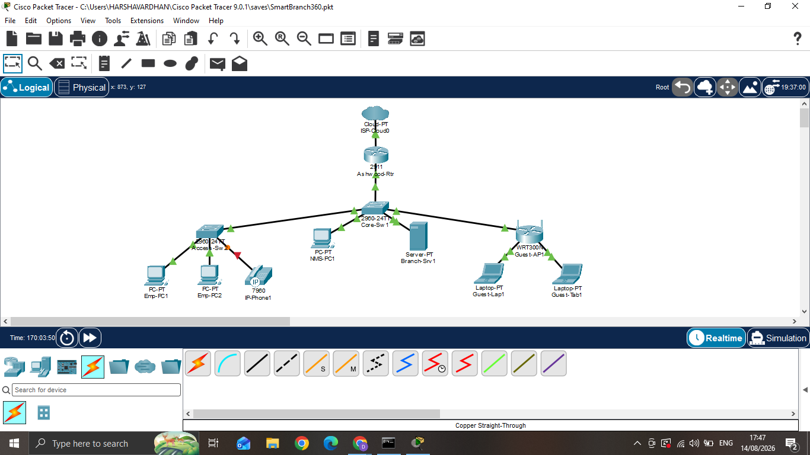

# SmartBranch 360

A branch office network design for a fictional retailer, **Northgate Retail Group**, built in **Cisco Packet Tracer** as part of the **Cisco Virtual Internship Program (VIP) 2025, Networking Track**. The repo also includes **NetGuard**, a small Python tool that checks the finished build against its design plan and reports PASS/FAIL results.

## What's in this repo

| File / folder | Purpose |
| --- | --- |
| `SmartBranch360.pkt` | The Packet Tracer project (open with Cisco Packet Tracer) |
| `plan.json` | The intended design: VLANs, IP addressing and security rules |
| `netguard.py` | NetGuard, the config assurance tool |
| `evidence/` | Device command output captured from the Packet Tracer build |

## Network design

The branch network covers:

- **VLAN segmentation** of branch traffic, with VLANs carried over a trunk link
- **Inter-VLAN routing** using router sub-interfaces
- **DHCP** for client addressing
- **ACLs** to control traffic between segments (for example, keeping Guest traffic away from Server resources)
- **NAT overload** so branch hosts can reach outside networks

The exact VLAN IDs and addressing are defined in `plan.json`.

## NetGuard: config assurance tool

NetGuard validates the built network against `plan.json` and prints a PASS/FAIL finding for each check. It reads these files from the `evidence/` folder:

| Evidence file | Command it was captured from |
| --- | --- |
| `show_vlan.txt` | `show vlan brief` |
| `show_trunk.txt` | `show interfaces trunk` |
| `show_ip_int_brief.txt` | `show ip interface brief` |
| `show_run_acl.txt` | `show run`, access-list section |
| `show_ip_nat_stats.txt` | `show ip nat statistics` |

Examples of problems it detects:

- Missing VLANs
- VLANs pruned from the trunk
- Wrong sub-interface gateway addresses
- An ACL that does not block Guest to Server traffic
- NAT overload not active

### Run it

Requires Python 3.

```bash
python3 netguard.py --plan plan.json --evidence ./evidence
```

On the included evidence, all checks pass.

## Screenshots



## Skills demonstrated

VLANs and trunking, inter-VLAN routing, DHCP, ACLs, NAT, Cisco Packet Tracer, and Python scripting for network validation.
